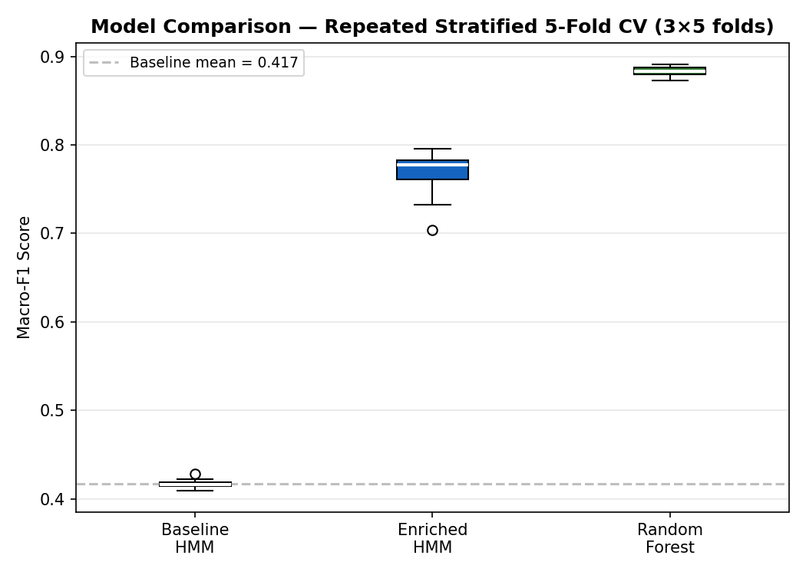

# GeoLife Trip-Purpose Classification

An academic mobility-modelling study comparing trajectory-only Hidden Markov Models (HMMs), semantically enriched HMMs and a Random Forest classifier for trip-purpose classification.

Completed for **AMI295: Business Intelligence** in the Data Science master's programme at Dalarna University, Sweden. The project combines GPS preprocessing, trip segmentation, feature engineering, weak supervision and comparative model evaluation.

## Start here

- [Revised final report](report.pdf)
- [Presentation](presentation.pptx)
- [Analysis pipeline](pipeline.py)
- [Recorded model results](results_summary.csv)
- [Individual fold results](results_fold_detail.csv)

## Study design

The pipeline uses Microsoft GeoLife trajectories, segments trips at gaps of at least 20 minutes and excludes segments with fewer than 10 points. It derives movement features and destination context to distinguish five categories: commute, education, shopping, leisure and other.

The semantic context is **synthetically generated POI data**, not a downloaded, independently verified OpenStreetMap POI dataset. Labels are generated using heuristic rules combining destination context and temporal or movement signals. They are weak labels, not independently observed trip purposes.

Three models are compared:

| Model | Inputs |
|---|---|
| Baseline HMM | Trajectory-derived features |
| Enriched HMM | Trajectory and synthetic semantic features |
| Random Forest | Combined feature set |

The HMM implementation constructs synthetic observation sequences from trip-level features. Its hidden states should not be treated as independently validated stages of real travel.

## Recorded results

The existing results file reports macro-F1 across five stratified folds repeated three times:

| Model | Mean macro-F1 | Standard deviation |
|---|---:|---:|
| Baseline HMM | 0.4170 | 0.0044 |
| Enriched HMM | 0.7686 | 0.0239 |
| Random Forest | 0.8835 | 0.0049 |

These values are copied from the original saved results, not a new execution.



## Interpretation and limitations

The results measure agreement with the project's heuristic labels. Some signals used to create those labels also appear among the model predictors, so the scores do not establish accuracy against independently verified travel intent.

Cross-validation is stratified at the trip level rather than grouped by user. Trips from the same person may appear in training and validation partitions. Repeated folds also overlap, so the 15 scores are not independent replications.

Synthetic POIs, constructed observation sequences and the sampling context further limit transfer to real-world travel-demand analysis. Independent labels and user-separated or temporal evaluation would be necessary to assess generalisation beyond this experiment.

Some original source comments describe OpenStreetMap context. The implementation and this README should be read with the synthetic-POI clarification above. The original code is preserved rather than silently rewritten.

## Files

| File | Purpose |
|---|---|
| `pipeline.py` | Preprocessing, feature generation, model comparison and output generation |
| `requirements.txt` | Original dependency specifications |
| `results_summary.csv` | Aggregate recorded model scores |
| `results_fold_detail.csv` | Recorded fold-level scores |
| `fig_model_comparison.png` | Score comparison |
| `fig_feature_importance.png` | Random Forest feature importance |
| `fig_label_distribution.png` | Weak-label distribution |
| `fig_correlation_heatmap.png` | Feature correlations |
| `fig_confusion_matrix.png` | Recorded Random Forest confusion matrix |
| `report.pdf` | Revised final academic report |
| `presentation.pptx` | Original final presentation |

## Data and setup

The raw GeoLife dataset is not bundled. Obtain **GeoLife GPS Trajectories, version 1.3**, from Microsoft Research and retain its original directory structure. The script expects:

```text
Geolife Trajectories 1.3/
    Data/
        000/
            Trajectory/
                ...plt
        ...
```

Place that folder beside `pipeline.py`. Use the dataset under its applicable terms and retain the original attribution.

With a Python environment prepared, install the supplied dependencies and run from the repository folder:

```bash
python -m pip install -r requirements.txt
python pipeline.py
```

The script reads configuration constants near its beginning, creates intermediate files in `.cache/` and writes figures and result CSVs beside the script. Running it overwrites the corresponding published output files in that local checkout. Runtime depends on the environment and available data.

## Contribution and publication context

The academic submission is labelled Group 26 and retains its original author attribution in the report, presentation and source. Al Amin Alif performed the project's implementation and analysis.

This publication preserves the existing pipeline, dependencies, figures and result files. The revised report is included as `report.pdf`; the presentation retains the original submission context. Packaging added documentation and an ignore file, without rerunning the study or changing its code.

Related course collection: [Business Intelligence MSc](https://github.com/iamalif/business-intelligence-msc).

## Skills demonstrated

Python, GPS data processing, geospatial analysis, feature engineering, weak supervision, Hidden Markov Models, Random Forests, scikit-learn, cross-validation, model interpretation and academic reporting.
